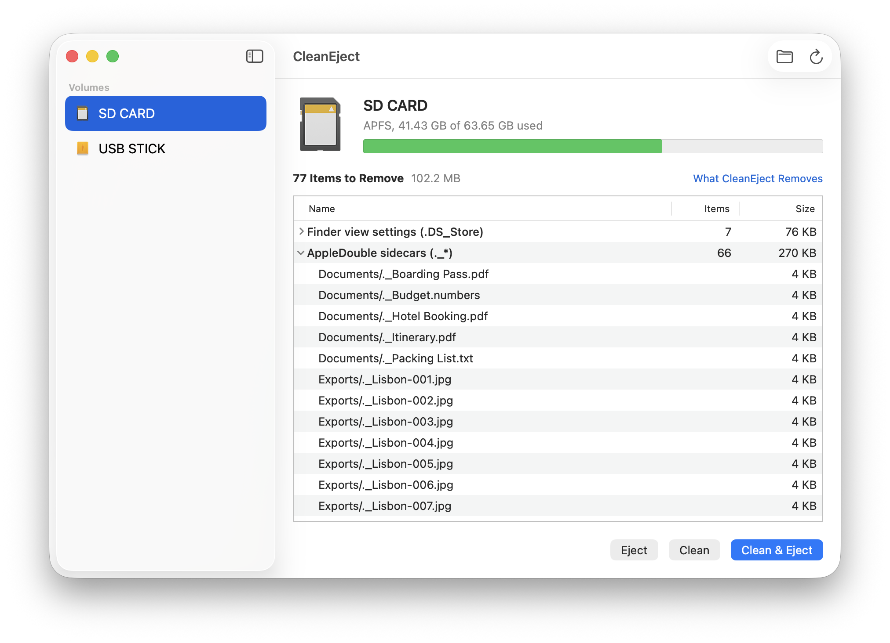

# CleanEject

A small, free macOS app that removes the metadata junk macOS leaves on external volumes (`.DS_Store`, `._*` files, `.Spotlight-V100`, ...) and then ejects them. Native SwiftUI, no third-party dependencies. A FOSS replacement for apps like Hidden File Cleaner.

<picture>
  <source media="(prefers-color-scheme: dark)" srcset="docs/images/window-dark.png">
  
</picture>

## Features

- Cleans and ejects external volumes in one step.
- Shows what would be removed before anything is deleted.
- Cleans folders and ZIP archives too.
- Menu bar item, "Clean with CleanEject" in Finder, and a command-line tool.
- Removes only documented names, nothing else.

## Install

Requires macOS 14 or newer and Xcode 16 or newer.

```sh
git clone https://github.com/albxncom/clean-eject
cd clean-eject
make install
```

The app is not notarized; on first launch Gatekeeper may ask you to confirm (right-click, Open). Removing `.Spotlight-V100` needs Full Disk Access, see [docs/permissions.md](docs/permissions.md).

## Command line

```sh
cleaneject list
cleaneject preview /Volumes/SD
cleaneject clean /Volumes/SD --eject
```

All commands and options: [docs/command-line.md](docs/command-line.md).

## Documentation

- [Usage](docs/usage.md)
- [What it removes](docs/rules.md)
- [Command line](docs/command-line.md)
- [Permissions](docs/permissions.md)
- [How it works](docs/how-it-works.md)
- [Development](docs/development.md)

## License

MIT, see [LICENSE](LICENSE).
