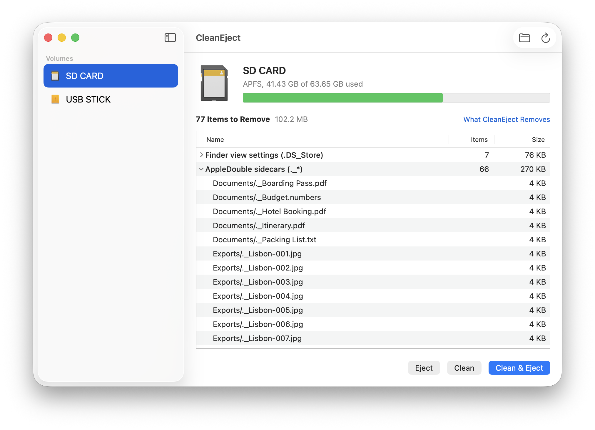
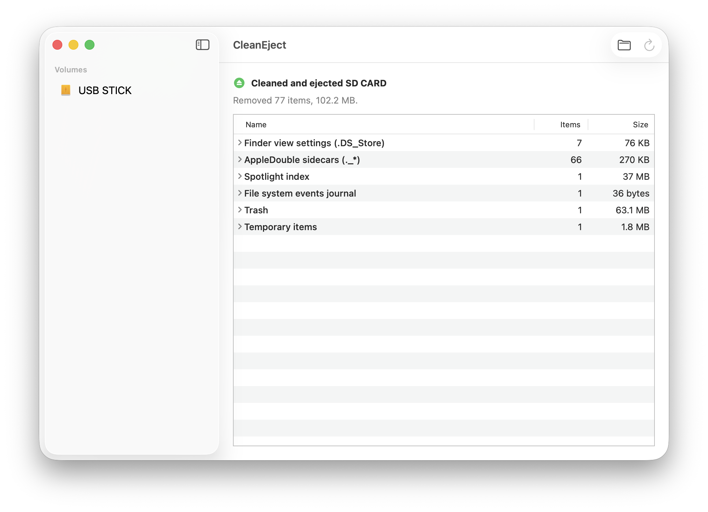

# Usage

The window is a sidebar of targets with a detail pane, like Disk Utility. Selecting a target scans it; the detail shows what would be removed, and the action buttons do the removal.

<picture>
  <source media="(prefers-color-scheme: dark)" srcset="images/window-dark.png">
  
</picture>

## Volumes

Launch CleanEject. The sidebar lists every mounted external volume: local, browsable, writable, and removable, ejectable or not internal. A card in the built-in SD reader counts as internal but removable and is listed. Network shares, hidden volumes and system volumes are not listed. The startup volume, fixed internal disks and anything under `/System/Volumes` are never cleaned, however they were selected.

Select a volume. The detail shows its icon, format and capacity, and the buttons Eject, Clean and Clean & Eject. Clean & Eject is the default button (Return, or ⌘E in the Volume menu).

## Scanning and findings

Selecting a target (a sidebar click, a newly mounted volume, a drop, File > Open…, the Finder service) starts a read-only scan of it. Nothing is changed. Only the selected target is scanned; selecting another one stops the scan of the previous one, and it starts again when you select it again.

While scanning, the detail shows "Looking for items to remove…" with the folder being read and a small Stop button (Escape). The action buttons stay enabled: pressing Clean, Clean & Eject or Eject stops the scan first and then runs. A stopped scan stays stopped until you choose Scan Again or select the target again.

When the scan is done, the findings appear below the header: a headline such as "1,275 Items to Remove" with the total size, then a table grouped by rule with the item count and size of each group. Expand a group to see its paths. If nothing was found, the detail says "No items to remove, <name> is already clean." Items that could not be read are listed under "Could Not Be Read". When the merge rule applies, a caption says so.

Scan Again (⌘R, toolbar) scans the selected target once more. The scan uses the rules in Settings > Rules (⌘,). When you change a rule, findings made with other rules are dropped and the selected target is scanned again, so what you see is what gets removed. A real run uses exactly the rules of the findings on screen.

The window scans only while it is open: a volume that mounts while the window is closed (menu bar mode) is scanned when the window opens.

## Actions and shortcuts

| Action | Where | Shortcut |
| --- | --- | --- |
| Clean & Eject | volumes, default button | Return, ⌘E |
| Clean | volumes, folders, archives | |
| Eject | volumes | ⇧⌘E |
| Scan Again | toolbar, Volume menu | ⌘R |
| Open… | toolbar, File menu | ⌘O |
| Stop | while scanning | Escape |
| Cancel | during a clean | Escape |

Folders and archives offer Clean only, as their default button. The buttons also work when the scan found nothing; Clean & Eject on a clean volume is a plain eject.

## Results

After a run the detail shows the result, for example "Removed 42 items, 1.2 MB", with the same grouped table for the removed items (a folder removed as a whole is one entry ending in "/"), the failures with their reasons, and "Merged 12 sidecars into their files" when the merge rule did something. A plain Clean keeps the result on screen until Scan Again or a rule change. After Clean & Eject the volume leaves the sidebar and the detail keeps that run's result until you select something else or a new volume mounts.

<picture>
  <source media="(prefers-color-scheme: dark)" srcset="images/result-dark.png">
  
</picture>

Problems never abort a run: items that cannot be removed are counted and listed, and an eject failure (volume busy) shows the system message while the volume stays listed. A permission problem with `.Spotlight-V100` comes with an "Open Full Disk Access Settings" button, see [permissions.md](permissions.md).

## Folders and archives

Drop folders and ZIP archives on the window or the Dock icon, use File > Open… (⌘O), or select them in Finder and choose "Clean with CleanEject" from the Services menu (right-click > Services, or the application menu; available after `make install`). They appear in a second sidebar section, "Folders & Archives", and are scanned like volumes. A folder's detail offers "Clean Whole Volume Instead" when its volume may be cleaned.

How a drop resolves:

- A volume adds the volume, including volumes the automatic list would skip, such as network shares and disk images.
- Any other folder adds that folder.
- A `.zip` file adds the archive.
- Any other file adds the folder that contains it (the volume itself when the file sits at its root).

Adding never deletes anything by itself. Remove a folder or archive from the list with its context menu or the Delete key; an item whose path disappears leaves the list on its own. What folders and archives lose is described in [rules.md](rules.md).

## Menu bar

Settings > General > "Show in Menu Bar" (on by default) keeps CleanEject available as a menu bar item. Closing the window then hides the Dock icon while the app keeps running; the menu bar item lists the volumes with Clean & Eject, Clean and Eject, which run directly without a scan, and "Open CleanEject" brings the window and Dock icon back. A run started from the menu bar while the window is closed reports its result as a notification. With the toggle off, closing the window quits the app.
